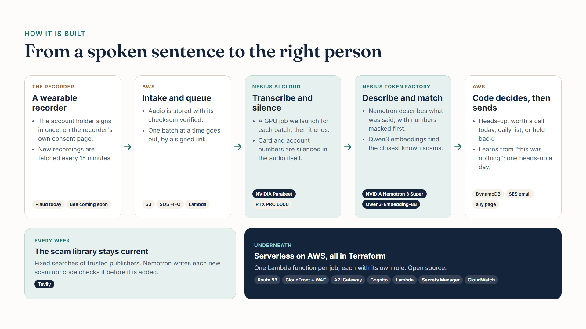

# Hearally

**Keeps the people on your side close.** You pick your allies. You decide what each one hears.

Hearally passes along what was mentioned out loud near a [Plaud](https://plaud.ai) recorder to the **allies** the account holder chose, by email, with a private link to their own page. Allies need no device and no account.

**It reports what was said. It does not detect what happened.** No fall detection, no health monitoring, no emergency response.

Speech is transcribed by NVIDIA's open **Parakeet** model on GPU servers Hearally runs on Nebius AI Cloud. Deciding what is worth passing on uses NVIDIA's open **Nemotron**, hosted on Nebius Token Factory and used only with zero data retention enabled. Nothing is sent to a consumer chatbot.

> Hearally passes along things that were mentioned out loud. It is **not an emergency service** and **not a medical device**. It does not detect falls, accidents or illness, it may miss things, and it may flag things that turn out to be nothing. **In an emergency, call 911.** Care decisions are yours.

## Status: public preview (beta)

Live at [hearally.com](https://hearally.com), with a signed-in dashboard at [hearally.com/dashboard](https://hearally.com/dashboard/). Free during the preview; no payment details are collected.

**Recordings reach Hearally in two ways.** The account holder signs in to Plaud once from the dashboard, and new recordings are brought in about every 15 minutes with no computer (through Plaud's hosted MCP server; still being tested). Or the **collector**, a small program on a computer, sends recordings exported from Plaud: [hearally.com/setup](https://hearally.com/setup/) and [collector/README.md](collector/README.md).

**What works today:** sign-up with the terms and privacy policy, the in-app acknowledgement, both ways in, transcription with Parakeet on Nebius (account numbers silenced in the audio, transcripts deleted once read), the judgement with Nemotron and known scam scripts, and allies by email: invitation, confirmation on the ally's own page, heads-ups, "worth a call today", a daily list, and "this was nothing". Learning from "this was nothing" works too, and an ally can choose a phone call for heads-ups (CALL-E), after confirming their number with a texted code (built, still being tested). Text messages to allies are not part of the preview.



## Built for the Nebius × NVIDIA Global AI Hackathon

Personal AI track. **Demo video (3 minutes):** https://youtu.be/OIYDd4QhXy8

NVIDIA Parakeet for transcription with word timestamps and word confidence, in a GPU job Hearally launches on Nebius AI Cloud; NVIDIA Nemotron for the judgement, on Nebius Token Factory.

## Prior work, and what is new here

Hearally reuses the design and parts of the engine of an earlier prototype by the same author, built for a different wearable and a different model provider. The engine was copied into this repository and has diverged (see `docs/adr/0001-monorepo-and-copied-engine.md`). New in Hearally:

- **Capture is a wearable recorder** (Plaud today). Hearally works from the account holder's own words: often only their side of a call is recorded, and that is enough to tell what the call was about.
- **Models are NVIDIA open models on Nebius.** Parakeet runs in a GPU job Hearally launches on Nebius AI Cloud; Nemotron is hosted on Nebius Token Factory.
- **Redaction happens in the audio.** Account numbers are silenced in the waveform by the GPU job; the original is deleted as soon as the silenced copy exists.
- **Known scam scripts, by retrieval-augmented generation (RAG).** A curated library from the FTC, AARP, the IRS, the SSA and others, embedded with Qwen3 on Nebius Token Factory and matched by cosine similarity, in memory; the closest scams are shown to Nemotron as reference. Tavily keeps the library current every week.
- **Plaud sign-in.** Recordings come straight from the account holder's Plaud account, with no computer.
- **Confidence-aware messages.** Parakeet returns word confidence. When a recording is unclear, an appointment or a request for help waits for the daily list, and a heads-up says the recording was unclear.
- **The dignity filter** (docs/ARCHITECTURE.md section 6), which keeps embarrassing but unimportant material away from allies.

## Repository layout

```
backend/     Python 3.12 Lambda, modular monolith: handlers, services, repositories, providers
collector/   Node: Plaud audio in, paired with an account, sent to the API
web/         Static site, dashboard and ally page, built with Tailwind
transcriber/ The Parakeet GPU job run on Nebius AI Cloud
infra/       Terraform: production only, us-east-1
brand/       Logo, palette, the Cognito sign-in style
scripts/     deploy-production.ps1, set-secrets.ps1
docs/        Architecture, ADRs, contracts, evaluation, diagrams
```

## Trying it

Nothing to install: use [hearally.com](https://hearally.com). The [getting started guide](https://hearally.com/setup/) covers sign-up, connecting a Plaud and adding allies. New recordings take about an hour to appear, because transcription runs in batches.

## Checks you can run locally

The backend's tests use mock providers and never touch cloud resources or send a real message. From `backend/`, with Python 3.12:

```bash
pip install -e ".[dev]"
python -m unittest discover -s tests
ruff check src tests
mypy src
```

## Running your own copy (operator setup)

Hearally runs in one production environment (`docs/adr/0002-production-only.md`). Deploying your own copy needs your own accounts and keys:

- An **AWS account**, and your own Terraform state bucket: change `infra/production/backend.tf`, which points at the operator's.
- A **Nebius Token Factory** API key (Nemotron and Qwen3, with Zero Data Retention enabled).
- A **Nebius AI Cloud** project with a container registry and a service account's authorized key, for the transcription job (`transcriber/README.md`).
- A **Tavily** API key for the weekly scam-library refresh; optionally a **CALL-E** key for phone calls.
- Terraform 1.15+, Node 22, Python 3.12 and Docker.

```bash
git clone https://github.com/amathias/hearally.git && cd hearally
npm --prefix web ci && npm --prefix web run build   # build the stylesheet
terraform -chdir=infra/production init
terraform -chdir=infra/production plan
```

Deploying is one script, which builds the stylesheet, applies Terraform, uploads the site, invalidates the CDN and checks the API answers. Secrets are created empty by Terraform and filled by a second script:

```powershell
./scripts/deploy-production.ps1
./scripts/set-secrets.ps1 -Secret Nebius
```

Live endpoints: [hearally.com](https://hearally.com) and `https://api.hearally.com/v1/config`.

## Documentation

| Document | What |
|---|---|
| [docs/ARCHITECTURE.md](docs/ARCHITECTURE.md) | How Hearally works, as built |
| [AGENTS.md](AGENTS.md) | Product, data and engineering boundaries |

## Licence

MIT. See [LICENSE](LICENSE).
