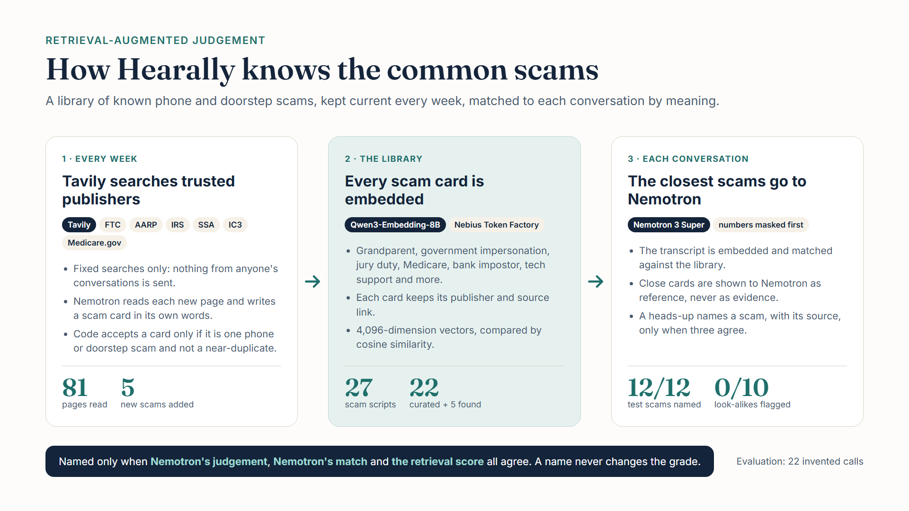

# Hearally architecture

How Hearally works, as built. Code comments refer to the numbered sections below.

## 1. What Hearally does

The **account holder** carries a Plaud recorder. Things get said that the people close to them would want to know: a caller pressing for an account number, a new appointment, a request for help. Hearally transcribes the recording, decides what is worth passing on, and tells the **allies** the account holder chose, in the way each ally chose.

**It reports what was said. It does not detect what happened.** It is not an emergency service, not a medical device, and not a monitoring service. Every message says so, and every item can be marked "this was nothing".

The account holder owns the data and the rules. Allies have no account, no app and no device: an ally's whole interface is a private link.

## 2. How recordings arrive

Two ways, both ending in the same intake:

- **Plaud sign-in.** The account holder signs in to Plaud once, on Plaud's own consent page (OAuth 2.1 with PKCE, through Plaud's hosted MCP server). Hearally's servers keep the sign-in, apart from every other record, and every 15 minutes list recordings made **after** the account connected and fetch their audio. Labelled a preview: Plaud has not yet published terms for services using it this way.
- **The collector.** A small Node program on a computer, paired with the account by a one-use code, sends recordings exported from Plaud into one folder (`docs/contracts/collector-pairing.md`).

Either way, the audio is stored at `incoming/<account>/<sha256>` with its checksum verified, a short record is kept for the dashboard, and the recording is queued (SQS FIFO) for transcription. Nothing is brought in until the account holder has accepted the acknowledgement (section 9).

## 3. Transcription

NVIDIA's open **Parakeet TDT 0.6B v3** runs as a GPU job on **Nebius AI Cloud** that Hearally launches and operates (`transcriber/`).

- **Dispatch, every 30 minutes**: queued recordings become one batch and one job. The job gets one signed link to a manifest of further signed links; it holds no AWS credentials.
- **The job**: converts the audio, cuts long recordings at quiet points, transcribes them with word timings and word confidence, and **silences account and card numbers in the audio itself** (any run of number words worth four or more digits, found by word timing). It uploads the transcript and the silenced copy.
- **Collect, every 10 minutes**: for each finished job, judge the transcript (section 4), store the results, delete the **original** audio once the silenced copy exists, and delete the transcript. **Raw transcripts are never kept.**
- A failed job is retried once with fresh links. Each step runs one at a time.
- **Listening to the silenced copy**: for the 7 days it is kept, the account holder can play it from Integrations → Recordings received. The API signs a 10-minute link to that one file, built from the caller's own account, never from the request (`backend/src/hearally/handlers/recordings.py`); the function may read `redacted/` and nothing else, and the site's content security policy allows audio from the media bucket only.

## 4. The judgement

NVIDIA's open **Nemotron**, on **Nebius Token Factory** (hosted, used only with Zero Data Retention enabled), describes what was said. **Code decides** what happens.

- **Built around what the wearer says.** Often only the account holder's own voice is recorded, and Hearally does not record or advertise recording the other side of a call. The category, the pressure signs and the summary are judged from the wearer's words ("you want my *whole* card number?", "gift cards?"), reported as their side ("they questioned being asked for their card number"), never inventing what anyone else said. In code: the wearer's own closing lines in a pressuring call ("I'll call my bank myself") are folded into that one item, and a call about one appointment is one item.
- **One conversation at a time.** A recording is cut wherever nobody spoke for 60 seconds, and each conversation is judged separately, so a day's recording never becomes one "call".
- **Numbers are masked** before anything is sent to the model.
- **Grades.** A *priority heads-up* is a call that sounded like a common scam script, with concrete pressure signals. *Worth a call today* covers things like a new appointment or a request for help. Everything else is the *daily list*.
- **Confidence gate.** An item can only become a heads-up if the plain words of its conversation (no punctuation, no sentence-start capitals, at least 8 words) have a median confidence of 0.65 or more (lowered from 0.80 after clear conversational speech measured 0.71). The whole conversation is measured, not only the lines the model cites, which vary between runs. Each item stores the reasons for its grade, and the collector logs the numbers behind it. Below the bar, an appointment or a request for help stays on the daily list. Pressure for money or details with concrete signals is always passed on as a heads-up, saying the recording was unclear: the score measures how spread out the model's guesses were, not whether the words are right.
- **The once-a-day budget** for heads-ups is a conditional write in the database, not a prompt instruction.

## 5. Known scam scripts

A curated library of common phone and doorstep scams (grandparent, government impersonation, jury duty, Medicare and others), each card sourced from the FTC, AARP, the IRS, the SSA, US Courts, IC3 or Medicare.gov (`backend/src/hearally/scam_cards.json`).

- **Retrieval-augmented generation (RAG).** Each conversation is matched against the library with **Qwen3 embeddings** on Token Factory, by cosine similarity, in memory; close cards are shown to Nemotron as reference, never as evidence, and the output schema only accepts a card that was shown.
- A heads-up **names** a script only when the model's judgement, the model's match and the retrieval score all agree. The email then says what the call sounded like and links the publisher's own page. A named script never changes the grade.
- **Kept current weekly with Tavily**: fixed searches of trusted publishers only. Code accepts a new card only if it describes one phone or doorstep scam and is not a near-duplicate of an existing card.
- Evaluation: `docs/eval/scam-retrieval.md`.



The counts in the picture are from October 2026.

## 6. The dignity filter

A recorder that runs through someone's day captures things that are nobody else's business. Every item passes the dignity filter before it can reach an ally, and **no ally can turn it off**.

- **Media is never an item.** Television, films, podcasts and music playing in the room are dropped.
- **Relevance and sensitivity**: each candidate is labelled for both, and code enforces the matrix:

| | Not sensitive | Sensitive |
|---|---|---|
| **Relevant** | Normal path | Paraphrased to the minimum; never quoted, never clipped |
| **Not relevant** | Normal path | **Dropped** |

- **Topics that never leave**: the account holder names topics under Preferences; an item mentioning one, in its summary or in what was said, is held back the same way (`backend/src/hearally/topics.py`). Scam pressure and requests for help are exempt here too.
- What was held back is listed for the account holder alone, who can **send it anyway**: it then joins the allies' next daily list, never sooner.

## 7. Allies and what gets sent

- **Adding an ally**: name, email, an optional relationship, and what they hear: *everything (heads-ups, worth a call today, the daily list)*, *heads-ups only*, or *nothing for now*. Up to five; one is the **first ally**.
- **The ally link**: a 256-bit random token, of which only a digest is stored. It travels in the URL **fragment** (`/a/#t=…`), which browsers never send to a server, and the ally page posts it in request bodies. Removing an ally revokes their link at once.
- **Allies consent too.** Before anything reaches them, an ally reads five short statements (not an emergency service, will miss things, may be nothing, nobody is on duty, can stop at any time), ticks one box agreeing to them and to the terms of use and privacy policy, and confirms. Each decision is recorded, append-only.
- **Delivery**, enforced in code:
  - a **heads-up** goes at once to every confirmed ally who hears heads-ups;
  - **worth a call today** goes to the first ally, held to the end of their quiet hours (21:00 to 08:00 in their time zone unless they change them, with their daily-list time, on their own page);
  - everything else arrives in a **daily list** at 18:00 their time.
- A delivery job claims each due message exactly once (a conditional delete), checks the ally is still confirmed, sends, and logs it. The account holder sees every message under **"what your allies heard"**.
- **"This was nothing"**: the ally picks a reason, which is kept with the item. If the item was a heads-up or worth a call today, what set it off (its category and pressure signals) becomes a **learned pattern** (`backend/src/hearally/learning.py`). A later item of the same kind that brings nothing new goes to the daily list instead, never further, and does not use the day's heads-up. One with a new element is graded as usual, and its message says what was new. Patterns last 90 days from the latest dismissal; the account holder sees them all under Preferences, "What Hearally has learned", and can remove any of them. Applied in code after the model has spoken; the model is never told.

## 8. Messages

Email through **Amazon SES** from `hearally.com`. Every message carries "not an emergency service" and a link to say it was nothing. Providers sit behind interfaces.

- **Heads-up calls** (`backend/src/hearally/calls.py`, `ally_phone.py`). An ally who hears heads-ups can choose to be phoned for one, from their own page. First they prove the number: a six-digit code by text through **AWS End User Messaging Notify** (US only; only a keyed hash of the code is stored, for ten minutes, five tries, three texts a day). Then they tick a box to turn calls on; every change is recorded, append-only. The call is placed by **CALL-E**: a short automated notice ("Hi Dana, this is Hearally with a notice about Dad"), a brief summary of the heads-up, a request to check their email, whose link opens the ally's page, and "Hearally is not an emergency service". It asks for nothing and ends.
- Enforced in code: heads-ups only; only confirmed allies with a proved number and calls on; never during the ally's quiet hours (the email still goes); at most **10 calls per account per calendar month** during the preview, a conditional counter claimed before each call and given back if the call cannot be placed. Each call, or why it was not placed, is logged under "what your allies heard".
- Text messages to allies are not part of the preview, apart from that one code.

## 9. The acknowledgement

Before any recording comes in, the account holder reads four points (not an emergency service and not a medical device; reports what was said, does not detect falls, accidents or illness, and will miss things and sometimes flag nothing; nobody is standing by and care decisions are theirs; they will only record what they have the legal right to record) and ticks one box confirming they have read them, are 18 or older, and agree to the terms of use and privacy policy. The acceptance is stored with a version, and a new version must be accepted again. Sign-up itself (Cognito Managed Login) links the terms of use and the privacy policy.

## 10. Data and privacy rules

- **Raw transcripts are never stored.** Summaries, structured metadata and the silenced audio are.
- **Retention**: unredacted audio is deleted once the silenced copy exists (a lifecycle rule is the backstop, within about two days); silenced audio 7 days; summaries, heads-ups, held-back moments and the recordings list 90 days.
- **Logs** never contain request bodies, transcripts, audio links, pairing codes, device tokens, ally contact details or link tokens.
- **Website analytics**: Google Analytics 4 on every page (`web/public/analytics.js`), loaded last so the ally page has already moved its token out of the address bar. It sends only page paths, never a query string or fragment (where ally-link tokens and sign-in codes travel), no page content and no user ID; Google signals and ad personalisation are off. The content security policy allows Google's tag and collection endpoints and nothing else of Google's.
- **Least privilege**: one IAM role per function, granted only the database partitions and storage prefixes it uses. The Plaud sign-in is kept in its own partition, out of reach of the dashboard.
- **Product rules live in code and conditional writes**, never in model prompts: the heads-up budget, quiet hours, the dignity matrix, the confidence gate.

## 11. AWS architecture and data model


```
Plaud ── Plaud sign-in (every 15 min) ──┐
      └─ collector (paired computer) ───┴──► S3 incoming/ ──► SQS FIFO
                                                              │
                                     dispatch (30 min) ───────┘
                                          │  one signed manifest link
                                          ▼
                              Nebius AI Cloud: Parakeet job
                                 transcript + silenced audio ──► S3
                                          │
                                     collect (10 min)
                                          │  Nemotron + scam scripts (Token Factory)
                                          ▼
                                   DynamoDB: items, outbox
                                          │
                                     deliver (10 min) ──► SES email ──► ally page /a/

Route 53 → CloudFront + WAF → API Gateway (Cognito JWT for the dashboard) → Lambda (Python 3.12, arm64)
```

- **Production only**, `us-east-1`, everything in **Terraform** (one CloudFormation stack, owned by Terraform, holds the Cognito terms links the provider cannot yet express). See `docs/adr/`.
- **Lambda**: one Python package, one function per handler, each with its own role and a 30-day log group. The transcription and ally functions share a layer with the Nebius SDK, time-zone data and the GPU job's code.
- **DynamoDB**: one table, `pk`/`sk`, with TTL. Account records live under `USER#<account>`; ally links under `LINKTOKEN#<digest>`; the Plaud sign-in under `PLAUD#<account>`; queued messages under `OUTBOX`; open transcription batches under `WORKER`.
- **S3 media bucket**: `incoming/` (unredacted, deleted after processing), `redacted/` (7 days), `transcripts/` and `jobs/` (deleted after use; one-day backstop).
- **Secrets Manager**: created empty by Terraform, filled by a script (`scripts/set-secrets.ps1`).
- **CloudWatch** alarms for every function, the API, the queues and the budget.

## 12. Brand

**Amber is the ally. Sand (on dark) or teal (on light) is the account holder**, everywhere allies appear: ally names, the ally page, "what your allies heard". The flag colour is a muted brick, never an alarm red: nothing should look like an alarm. Tokens and rules: `brand/`.

## 13. Running it

See the repository `README.md` for setup and deployment, and the component READMEs (`backend/`, `collector/`, `transcriber/`, `web/`).
